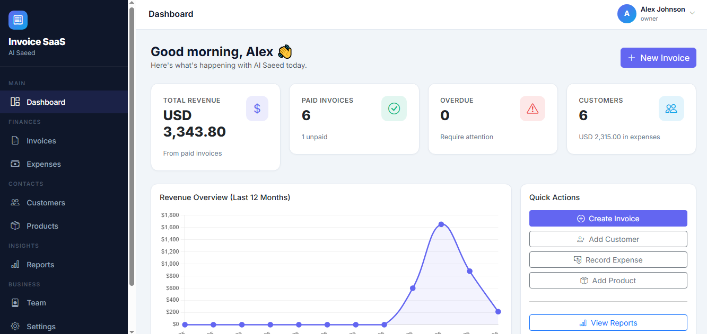
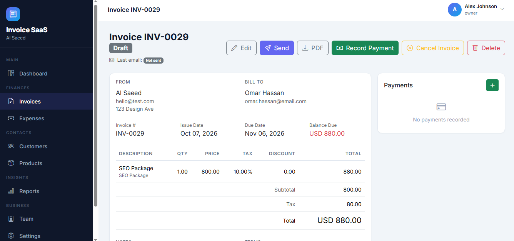
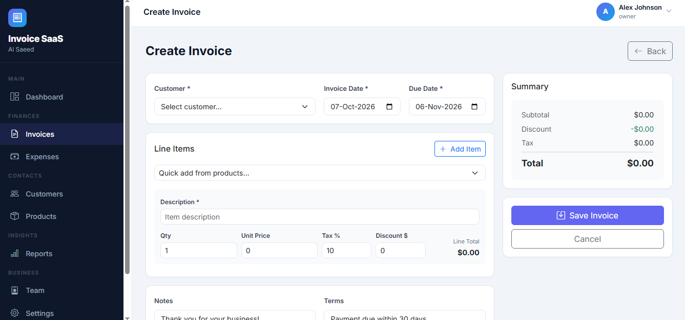
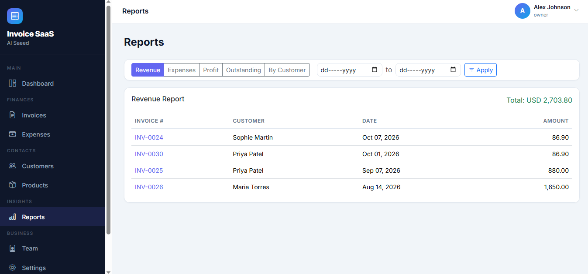
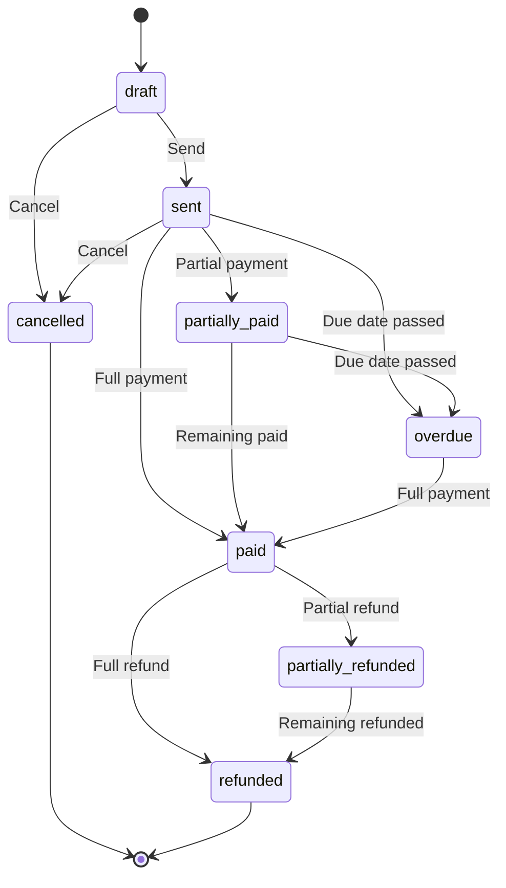

<div align="center">

# 🧾 Invoice SaaS

**A multi-tenant invoicing & expense platform built with Laravel 11.**
Create professional invoices, track payments and refunds, email clients automatically, and see your business at a glance.

[](https://laravel.com)
[](https://www.php.net)
[](https://getbootstrap.com)
[](#-tech-stack)
[](LICENSE)

[Demo Video](#-demo-video) · [Features](#-features) · [Quick Start](#-quick-start) · [Architecture](#-architecture) · [Testing](#-testing)

</div>

---

## 🎬 Demo Video

<p align="center">
  <a href="https://www.youtube.com/watch?v=nhL9TvERcnI" target="_blank" rel="noopener">
    
  </a>
  <br />
  <sub>▶️ Click the thumbnail to watch the full walkthrough on YouTube</sub>
</p>

---

## 📸 Screenshots

<table>
  <tr>
    <td align="center"><b>Dashboard</b><br /></td>
    <td align="center"><b>Invoice Details</b><br /></td>
  </tr>
  <tr>
    <td align="center"><b>Create Invoice</b><br /></td>
    <td align="center"><b>Reports</b><br /></td>
  </tr>
</table>

---

## ✨ Features

### 🧾 Invoicing
- Create, edit, send, cancel and delete invoices with **multiple line items**, per-item **tax rate** and **discount**
- **Atomic invoice numbering** (`INV-0001`, `INV-0002`, …) with database row locking, safe under concurrent requests
- Full status lifecycle: `draft` → `sent` → `partially_paid` → `paid` / `overdue` / `cancelled` / `partially_refunded` / `refunded`
- **PDF generation** (A4) via DomPDF, with download and in-browser preview
- Owner-only **bulk delete** and **delete all** actions on the invoice list

### 💳 Payments & Refunds
- **Manual payment recording**: log partial or full payments against any invoice, with the method (`cash`, `bank_transfer`, `card` or `other`) as a label
- ℹ️ **No online payment gateway is integrated.** Clients are not charged through the app; payments are entered by the owner or staff after money is received
- Issue **full or partial refunds**, with the invoice status recalculated automatically from net paid amount (payments − refunds)

### 📧 Smart Email Delivery
- Manual **Send** / **Resend** buttons, no surprise emails
- Emails are **queued** and processed by a background worker with **3 retries** and escalating backoff (30s → 2min → 5min)
- Context-aware templates: invoice, payment received, partial payment, refund, partial refund, cancellation
- **Stale-job protection**: if a newer email is queued, older pending ones are skipped automatically
- Per-invoice email status badge (`Not sent`, `Queued`, `Sent`, `Failed`) with the error message when delivery fails

### 👥 Customers, Products & Expenses
- Customer directory with soft deletes and a per-customer detail page
- Product / service catalog with default price and tax rate
- Expense tracking with **categories** and **receipt uploads** (stored privately, downloaded through an authenticated route)

### 📊 Dashboard & Reports
- Dashboard cards: total revenue, paid / unpaid / overdue invoices, customers, expenses
- **12-month revenue chart** (Chart.js) and recent invoices / payments feed
- Reports: **revenue**, **expenses**, **profit overview**, **outstanding invoices** and **revenue by customer**, all with date-range filters

### 🔐 Registration & Authentication
- **Self-service sign-up** at `/register`: one form creates your user account **and** your business workspace, and you become its **Owner** automatically
- Login, logout, forgot / reset password, email verification and password confirmation (Laravel Breeze)
- Staff are added by an owner using the email of an **already registered** user, so teammates sign up at `/register` first

### 🏢 Multi-Tenancy & Team
- Every record is scoped to a **business** through a global Eloquent scope; users can never see another business's data
- **Owner / Staff** roles: owners manage staff, settings and bulk deletes, while staff handle day-to-day work
- Authorization through Laravel **Policies** on top of the tenant scope (defense in depth)
- Business settings: logo upload, currency, invoice prefix and starting number, default tax rate, default notes and terms

### ⏰ Automation
- A daily scheduled command (`invoices:mark-overdue`) flips `sent` / `partially_paid` invoices to `overdue` once the due date passes

---

## 🔄 Invoice Lifecycle



---

## 🛠 Tech Stack

| Layer | Technology |
|-------|-----------|
| Framework | Laravel 11 (PHP 8.2+) |
| Auth | Laravel Breeze (Blade) |
| Frontend | Blade, Bootstrap 5.3, Bootstrap Icons, Alpine.js, Chart.js |
| Database | SQLite (default) or MySQL / MariaDB |
| Queue | Database queue driver |
| PDF | [barryvdh/laravel-dompdf](https://github.com/barryvdh/laravel-dompdf) |
| Permissions | [spatie/laravel-permission](https://github.com/spatie/laravel-permission) |
| Testing | PHPUnit (Feature + Unit) |

---

## 🚀 Quick Start

### Requirements

- PHP **8.2+** with `mbstring`, `xml`, `gd`, `pdo_sqlite` / `pdo_mysql`
- Composer 2.x
- Node.js 18+ and npm

### Demo Accounts

| Role | Email | Password |
|------|-------|----------|
| Owner | `owner@demo.com` | `password` |
| Staff | `staff@demo.com` | `password` |

> ⚠️ The seeded accounts are for local development only. Remove or change them before deploying.

### Create your own account

You can skip the demo accounts and sign up yourself:

1. Open **`/register`** (e.g. http://127.0.0.1:8000/register)
2. Enter your name, email, password and **business name**
3. You are logged in as the **Owner** of a fresh business and land on the dashboard. Set your logo, currency, invoice prefix and tax rate under **Settings**

> 💡 The login page currently has no "Register" link, so go to `/register` directly or add a link to `resources/views/auth/login.blade.php`:
> ```blade
> <a href="{{ route('register') }}">Create an account</a>
> ```

To add a teammate, they must first register at `/register`. Then, as the owner, open **Staff** and invite them by email.

### Run the background services

Emails are queued, so run a worker in a second terminal. The scheduler marks overdue invoices:

```bash
php artisan queue:work          # processes email jobs
php artisan schedule:work       # local scheduler (production: see below)
```

### Using MySQL instead of SQLite

```env
DB_CONNECTION=mysql
DB_HOST=127.0.0.1
DB_PORT=3306
DB_DATABASE=invoice_saas
DB_USERNAME=root
DB_PASSWORD=
```

### Email configuration

For local testing, keep `MAIL_MAILER=log` so emails are written to `storage/logs/laravel.log`. For real delivery, configure SMTP (Mailtrap, Mailgun, SES, Gmail, etc.) in `.env`.

#### Sending with Gmail (App Password)

Gmail does not accept your normal account password for SMTP. You need a 16-character **App Password**:

1. Turn on **2-Step Verification** for your Google account (required before App Passwords are available)
2. Open **https://myaccount.google.com/apppasswords**
3. Enter an app name (e.g. `Invoice SaaS`) and click **Create**
4. Copy the 16-character password Google shows. It is displayed only once, and you can remove spaces when pasting
5. Add it to your `.env`:

```env
MAIL_MAILER=smtp
MAIL_HOST=smtp.gmail.com
MAIL_PORT=587
MAIL_USERNAME=your-email@gmail.com
MAIL_PASSWORD=your-16-char-app-password
MAIL_ENCRYPTION=tls
MAIL_FROM_ADDRESS="your-email@gmail.com"
MAIL_FROM_NAME="${APP_NAME}"
```

6. Clear the config cache and **restart the queue worker**, since workers keep the old settings in memory:

```bash
php artisan config:clear
php artisan queue:restart
```

---

## 🧱 Architecture

```
app/
├── Console/Commands/      # invoices:mark-overdue
├── Http/
│   ├── Controllers/       # Invoice, Payment, Customer, Product, Expense, Report, Settings, Staff
│   ├── Middleware/        # EnsureUserHasBusiness (tenant session guard)
│   └── Requests/          # Form Request validation
├── Jobs/                  # SendInvoiceEmailJob (retries, backoff, stale-job skip)
├── Mail/                  # InvoiceMail (scenario-based)
├── Models/
│   └── Concerns/          # BelongsToTenant (global scope + auto business_id)
├── Policies/              # Invoice, Customer, Product, Expense
└── Services/              # InvoiceCalculationService, InvoicePdfService,
                           # DashboardStatsService, ReportService
database/
├── migrations/            # Schema + status, refund and email-tracking changes
└── seeders/               # Demo business, customers, products, invoices
tests/Feature/            # Tenant isolation, calculations, payment status, auth
```

**Design decisions**

- **Tenant isolation by default**: the `BelongsToTenant` trait applies a global scope and fills `business_id` on create, so a forgotten `where` can't leak data.
- **Business logic in services**: totals, PDF rendering, stats and reports live in dedicated service classes, which keeps controllers thin.
- **Net-paid accounting**: `amount_paid` is always recomputed from payments minus refunds, so status never drifts.
- **Idempotent email queue**: each queued email carries a token, and a job only sends if its token is still the latest.

---

## 🤝 Contributing

Contributions are welcome.

1. Fork the repository
2. Create a feature branch: `git checkout -b feature/amazing-feature`
3. Commit your changes: `git commit -m "feat: add amazing feature"`
4. Push the branch: `git push origin feature/amazing-feature`
5. Open a Pull Request

---

## 📄 License

Distributed under the **MIT License**. See [`LICENSE`](LICENSE) for details.

---

## 👨‍💻 Author

**Farhan Saeed** · Al Saeed Dev

🌐 [alsaeeddev.com](https://alsaeeddev.com)

<div align="center">

⭐ If this project helps you, please consider giving it a star!

</div>
